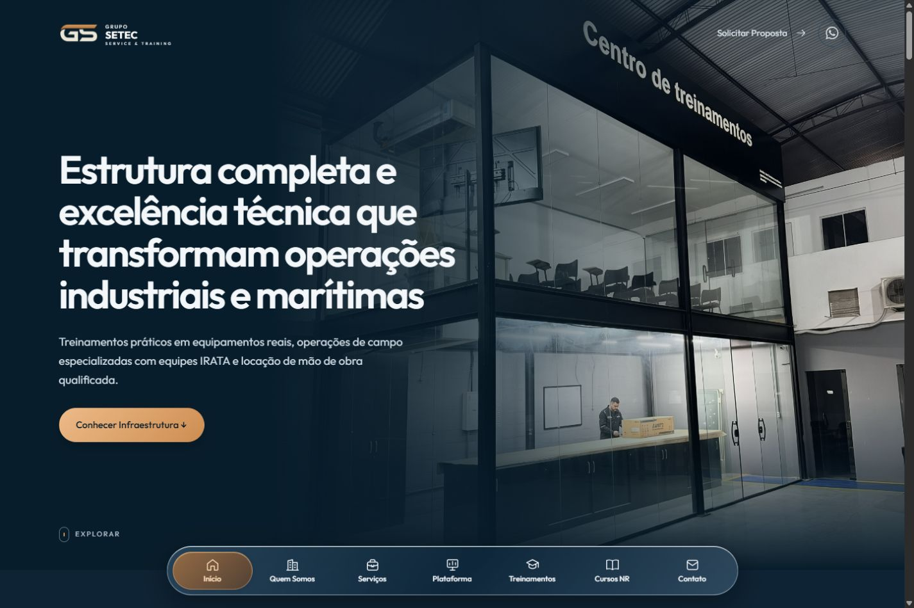
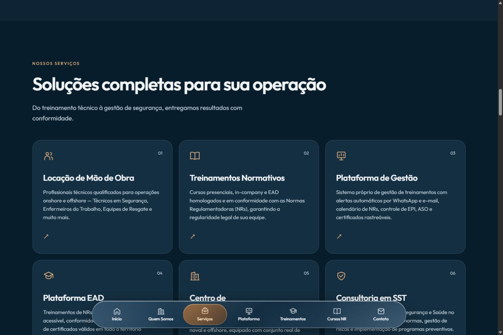
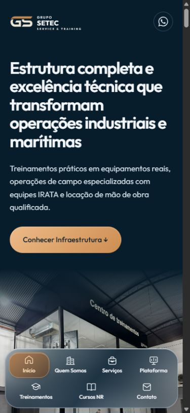

# Marinho imersivo — implementação e verificação

13 de outubro de 2026. Direção 02 aprovada pelo usuário. Trabalho local, sem publicação.

## Resultado

- Sistema marinho com cobre pontual, tipografia Outfit preservada, superfícies sólidas de leitura e vidro na camada de navegação.
- Sete destinos no desktop. Após ajuste solicitado, celular com Treinamentos, Serviços, Cursos NR e Contato em uma cápsula de uma linha; Início, Quem Somos e Plataforma em menu compacto no canto superior direito da hero. Menu nativo com fechamento por seleção, clique fora e Escape; ordenação do DOM acompanha o layout para uso do teclado.
- Indicador de seção animado, retorno visual dos controles, entradas discretas e rolagem natural. Sem animação contínua, scroll-snap ou dependência de hover para ler os textos.
- Fotografias reais da SETEC, hero responsivo, biblioteca SVG de ícones, galeria ampliável e ilustrações existentes de cursos e plataformas. Nenhum arquivo original de imagem ou logo foi alterado.
- Formulário com campos nativos, validação, foco e encaminhamento ao WhatsApp, com alternativa de link caso a nova janela seja bloqueada. Não apresenta confirmação fictícia de envio.
- Abas de NRs operáveis por teclado, categoria preservada ao voltar de um curso, filtros de aperfeiçoamento e diálogos com Escape e restauração de foco.
- Mesmo sistema nas 20 páginas NR e três documentos legais. Tabela de privacidade rolável por teclado em telas estreitas.

## Arquivos

Alterados: `index.html`, `style.css`, `script.js`, `nr/nr01.html`, `nr/nr05.html`, `nr/nr06.html`, `nr/nr08.html`, `nr/nr10.html`, `nr/nr11.html`, `nr/nr12.html`, `nr/nr13.html`, `nr/nr17.html`, `nr/nr18.html`, `nr/nr20.html`, `nr/nr23.html`, `nr/nr26.html`, `nr/nr29.html`, `nr/nr30.html`, `nr/nr32.html`, `nr/nr33.html`, `nr/nr34.html`, `nr/nr35.html`, `nr/nr37.html`, `termos-de-uso.html`, `politica-de-privacidade.html`, `compliance.html` e `README.md`.

Criados: `img/ui-icons.svg`, planejamento, script de migração utilizado uma vez, verificador estrutural e capturas em `design-study/`. O estudo e as quatro propostas anteriores foram mantidos como histórico; o estudo agora informa a escolha final da opção 02.

## Verificado

| Verificação | Evidência / resultado |
| --- | --- |
| Estrutura e referências locais | `python design-study/check_project.py`: 24 páginas; nenhum erro de estrutura, IDs, arquivos ou âncoras locais; sete destinos presentes em todas. |
| Conteúdo | Comparação automatizada de títulos, parágrafos, listas, labels, opções e classes de conteúdo contra o Git anterior: nenhuma remoção ou reescrita detectada. Espaçamento e ícones decorativos são normalizados na comparação. Mensagens funcionais e atributos acessíveis foram acrescentados. |
| Imagens e logos | Hashes de 77 arquivos originais idênticos ao Git anterior. |
| JavaScript | `node --check script.js`: passou. |
| Diff | `git diff --check`: passou após limpar espaços em linhas vazias. Git apenas informa sua conversão habitual LF/CRLF. |
| Home | Inspeção visual das 12 seções no navegador integrado. Ajustados transição da foto principal, altura da galeria e enquadramento do EAD. |
| Responsividade | Inspeções iniciais em 1440×960, 768×1024, 390×844 e 320×740. Após simplificação mobile, nova verificação em 390 e 320 px: quatro destinos em uma linha, barra de 72 px e alvos de 65×56 px na menor tela, sem transbordamento horizontal. Desktop novamente conferido com sete destinos e menu complementar oculto. |
| Navegação | Sete links clicados; destino e indicador atualizados; links reais preservam fragmentos de URL. |
| NRs | Abas por clique, seta direita, Home e End; foco e seleção sincronizados. Painéis com 6, 3, 4 e 7 cursos. NR-35 aberta a partir do catálogo e inspecionada em desktop e celular; retorno preserva Alto Risco. As outras 19 páginas foram verificadas estruturalmente, sem inspeção visual individual. |
| Aperfeiçoamento | Naval: 4 cartões; Elétrica: 2; Manutenção: 3. Estado `aria-pressed` acompanha a seleção. |
| Formulário | Envio vazio bloqueado com foco em Nome. E-mail inválido bloqueado com foco em E-mail. Dados fictícios apagados após teste. |
| Créditos | Abertura, Shift+Tab do primeiro ao último controle, Tab do último ao primeiro, Escape e retorno ao botão Rhenan Amorim confirmados. |
| Galeria | Foto ampliada, Escape fecha e devolve foco ao link de origem. |
| Documentos | Três páginas legais inspecionadas no desktop. Termos no celular, rolagem até o final confirmada. Privacidade em 320 px: página sem transbordamento; tabela interna 560 px, área visível 255 px, rolável pelo teclado. Cores herdadas e espaçamento corrigidos. |
| Console | Nova aba da primeira entrega percorreu os sete destinos sem erros ou avisos. A navegação mobile usa agora `script.js?v=mobile-nav-1` para renovar o cache; o novo menu foi testado sem erros ou avisos. |

## Ajuste da navegação mobile solicitado pelo usuário

Menu superior testado com clique e Enter, navegação por Tab entre Início → Quem Somos → Plataforma, fechamento por Escape com restauração de foco, fechamento por clique fora e fechamento ao escolher destino. Quem Somos e Plataforma navegam às respectivas seções e ocultam o indicador inferior, já que esses destinos pertencem ao menu superior. Os quatro destinos inferiores foram clicados. A ordem de foco acompanha a ordem visual; Tab após Treinamentos chega a Serviços. Em desktop, a ordem original dos sete destinos é restaurada.

Capturas atualizadas: `verification/mobile-nav-fechado.jpg` e `verification/mobile-nav-aberto.jpg`. As capturas de home anteriores abaixo documentam a primeira entrega e mostram a barra anterior. Os botões Explorar e Solicitar Proposta da hero também foram removidos por solicitação posterior, e o WhatsApp foi movido ao lado de Conhecer Infraestrutura.

Contrastes calculados pela fórmula de luminância relativa WCAG para pares sólidos: texto secundário sobre superfície 8,16:1; cobre claro sobre marinho 8,13:1; placeholder sobre branco 5,21:1; borda do campo sobre formulário 3,54:1; texto do botão sobre o extremo mais escuro do gradiente cobre 6,29:1. Isso verifica esses pares, não constitui certificação de acessibilidade integral nem medição de todos os fundos fotográficos/translúcidos.

## Evidências visuais

## Limites

- Não existe etapa de build ou suíte de testes prévia: é HTML/CSS/JavaScript estático. O README foi corrigido para usar servidor estático.
- Testado no navegador integrado baseado em Chromium, com viewports simulados. Safari/iOS, Firefox, aparelho físico, teclado virtual e leitor de tela não foram testados.
- Preferências de movimento reduzido, transparência reduzida e cores forçadas possuem regras de fallback no código; os ajustes do sistema operacional não foram alternados nesta sessão.
- Não houve envio real de mensagem, teste de entrega no WhatsApp, publicação nem integração de backend. A conclusão de envio continua sendo uma ação da pessoa no WhatsApp.
- Não houve auditoria Lighthouse nem simulação de rede lenta. Imagens inferiores usam carregamento lazy; a foto principal usa prioridade, dimensões e fontes responsivas. Fontes externas mantêm fallback de sistema.
- A prévia depende do servidor local ativo em `http://127.0.0.1:8765/`. Para reiniciar: `python -m http.server 8765 --bind 127.0.0.1` na raiz.

## Referências de projeto

Pesquisa e justificativas no estudo original. Princípios utilizados: materiais que preservam legibilidade, conteúdo como foco, navegação persistente e acessibilidade, adaptados a um site institucional B2B.

- [Apple Human Interface Guidelines](https://developer.apple.com/design/human-interface-guidelines/)
- [Apple — Materials](https://developer.apple.com/design/human-interface-guidelines/materials)
- [Apple — Accessibility](https://developer.apple.com/design/human-interface-guidelines/accessibility)
- [Apple Design Resources](https://developer.apple.com/design/resources/)
